# Screenshots

Real screenshots from QNX SDP 8.0 QEMU images made with `mkqnximage --graphics=yes` (virtio-gpu with
virgl, 1280x800), taken on the target with the SDP's `screenshot` tool. Every program was installed with
`apk add` from this repository's releases. How to build the same image and run them:
[docs/qemu-test-vms.md](../qemu-test-vms.md).

| | |
|---|---|
| 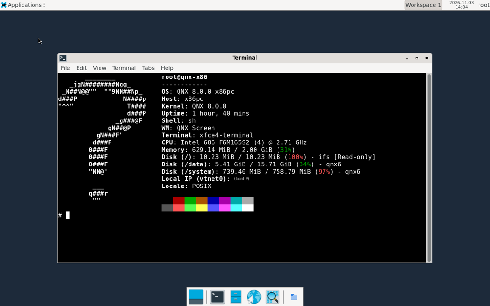 **labwc + Xfce panel on QNX Screen, fastfetch in xfce4-terminal** (x86_64) | 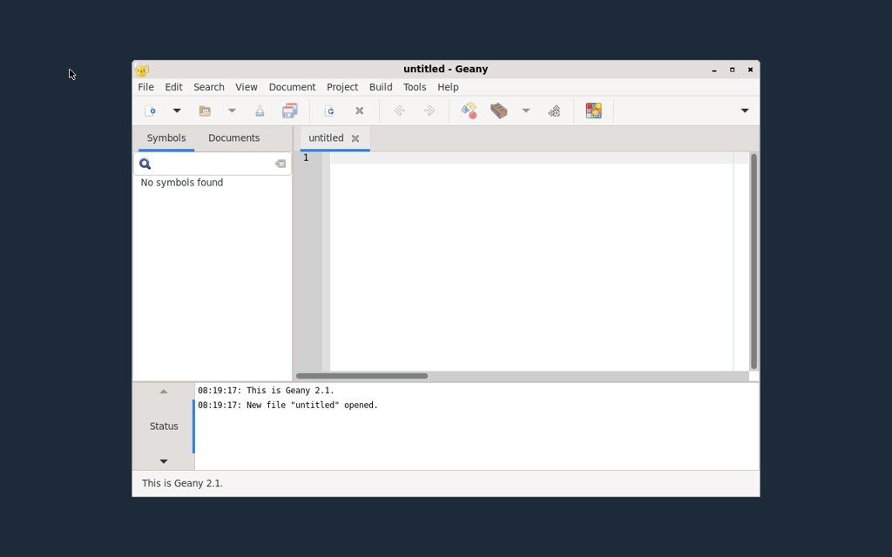 **Geany (GTK 3) on the labwc desktop** (x86_64) |
| 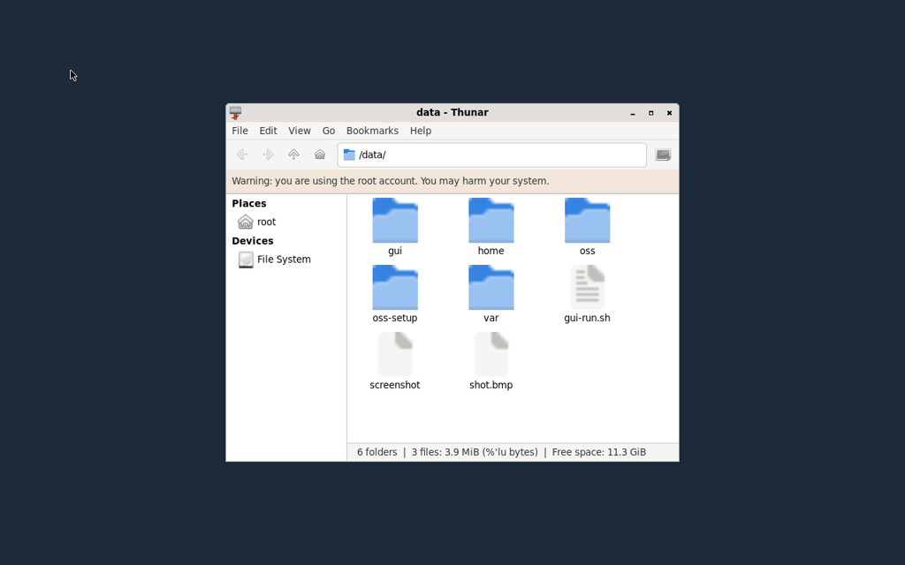 **Thunar file manager** (x86_64) | 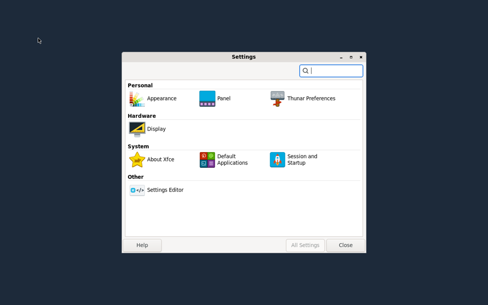 **Xfce settings manager** (x86_64) |
| 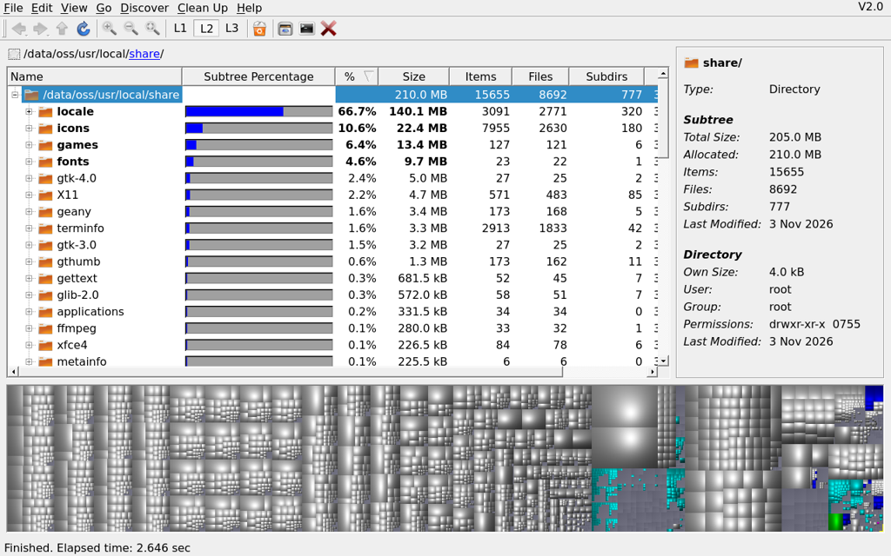 **QDirStat (Qt 6, QNX Screen platform plugin)** (x86_64) | 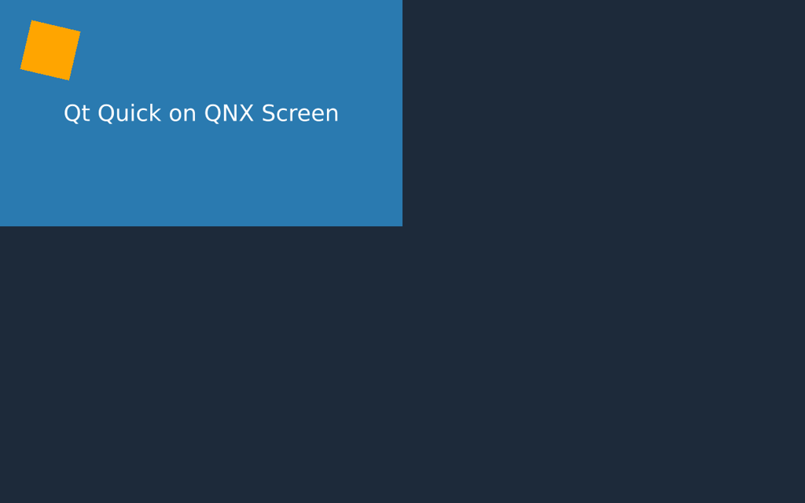 **Qt Quick (QML) straight on QNX Screen** (x86_64) |
| 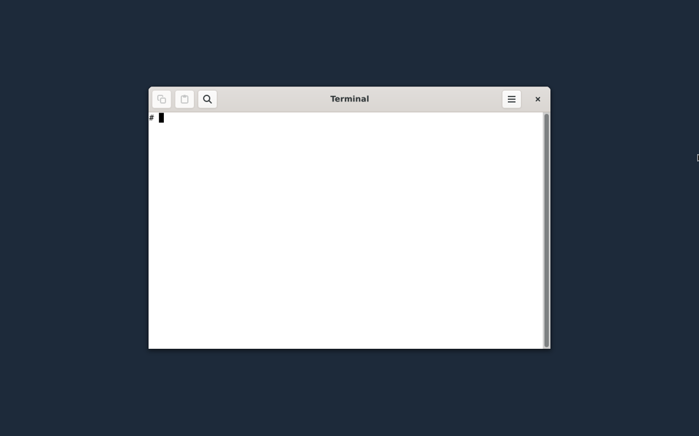 **VTE terminal on GTK 4 with the GL renderer** (x86_64) | 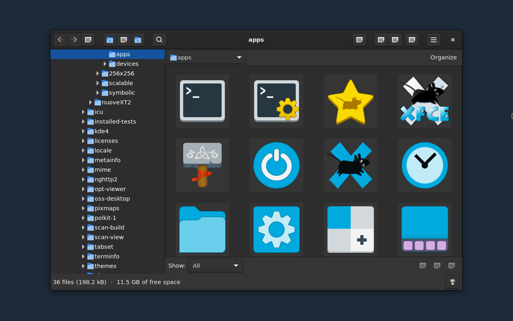 **gThumb image browser** (x86_64) |
| 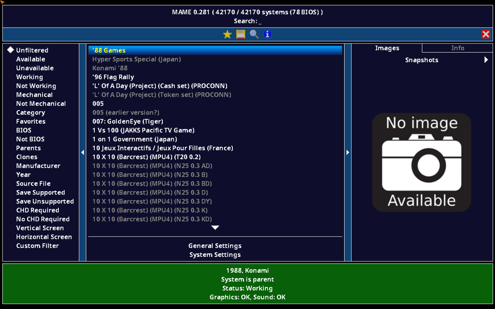 **MAME system list (SDL2 on QNX Screen)** (x86_64) | 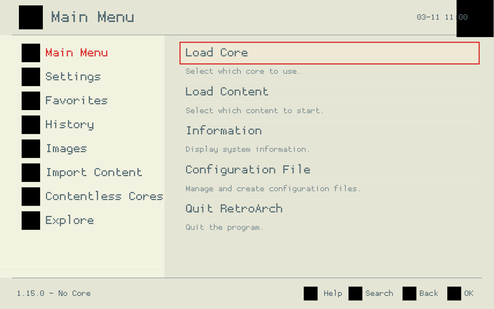 **RetroArch menu (GLES over EGL on Screen)** (x86_64) |
| 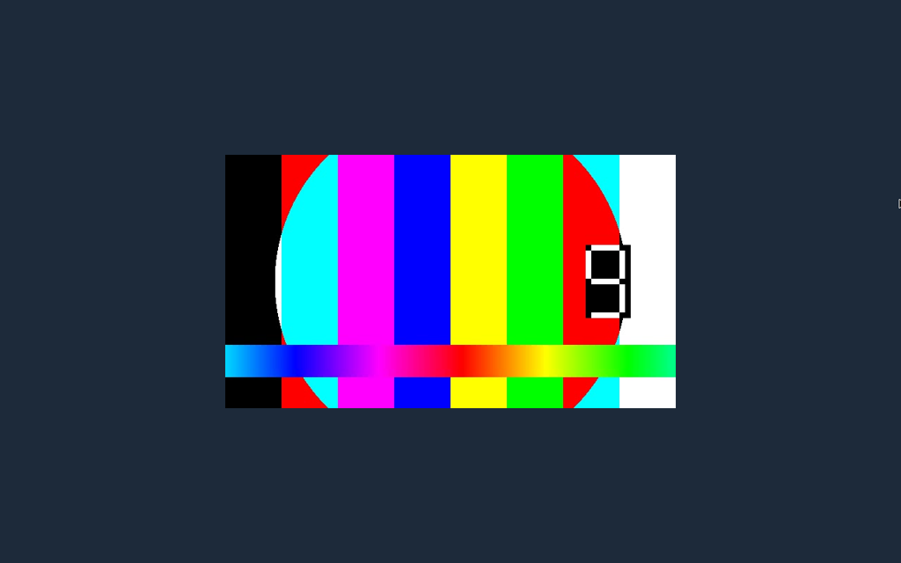 **VLC playing a test video (QNX Screen window module)** (x86_64) | 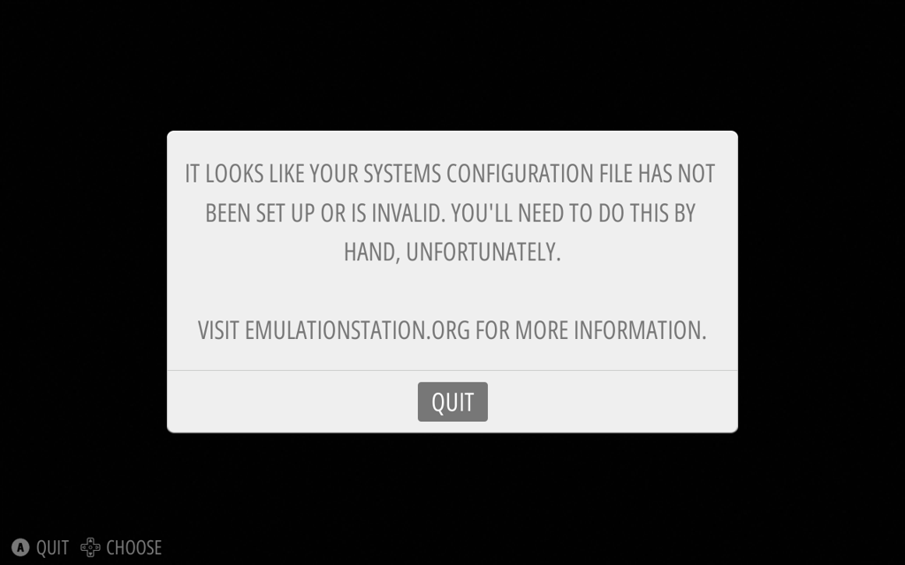 **EmulationStation (SDL2, GLES)** (x86_64) |
| 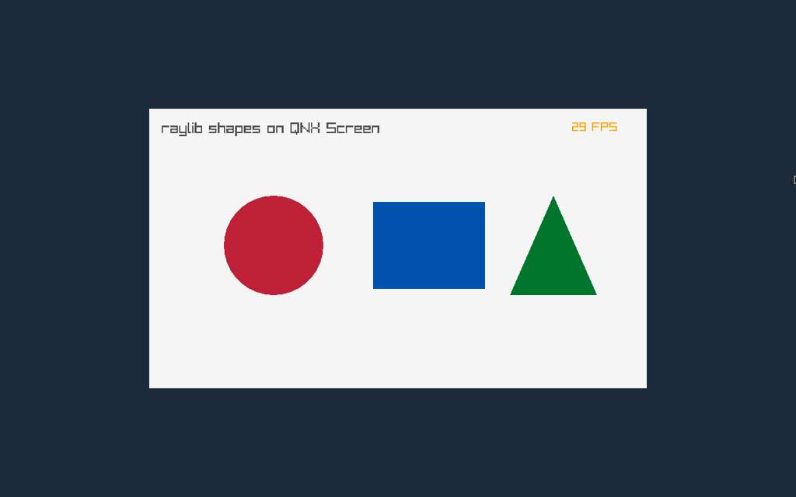 **raylib shapes (SDL2 + GLES 2)** (x86_64) | 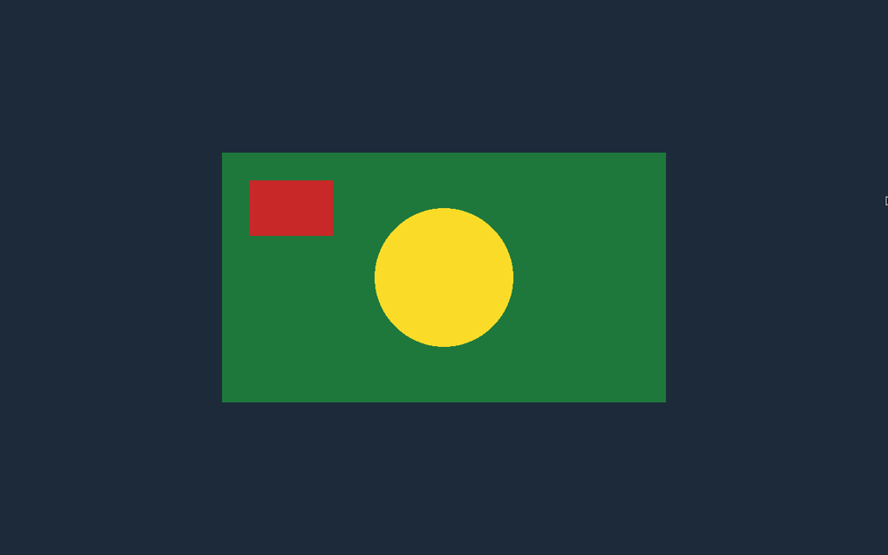 **pygame window** (x86_64) |
| 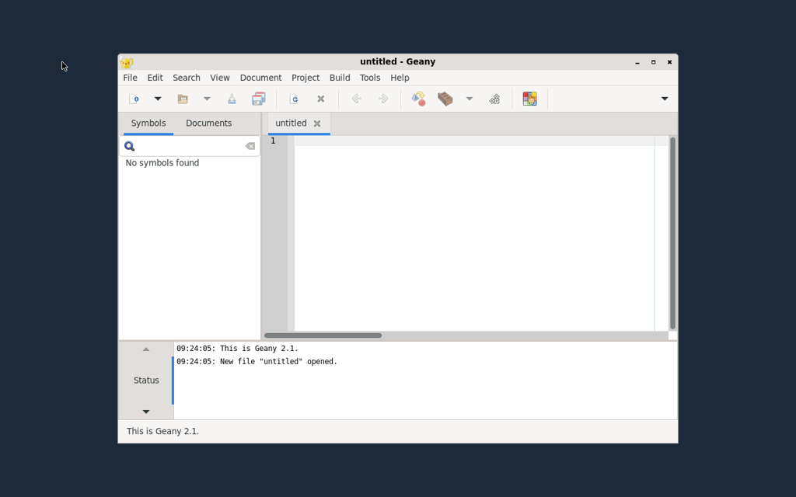 **Geany on the aarch64le desktop** (aarch64le) | 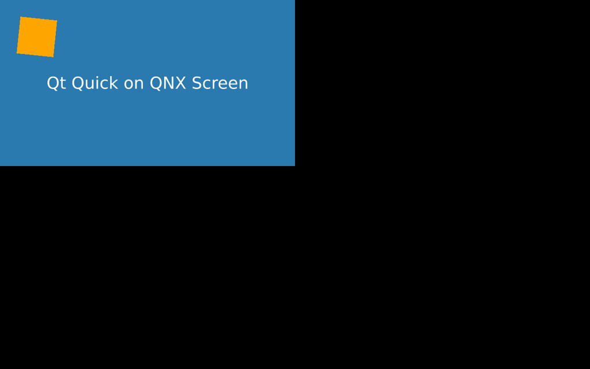 **Qt Quick on aarch64le** (aarch64le) |

Taken 2026-11-03. The desktop is labwc (wlroots on QNX Screen) with swaybg and the Xfce panel
(`apk add oss-desktop`); Qt programs draw on QNX Screen directly (`QT_QPA_PLATFORM=qnx`); SDL2, RetroArch
and VLC use QNX Screen with GLES over EGL.
